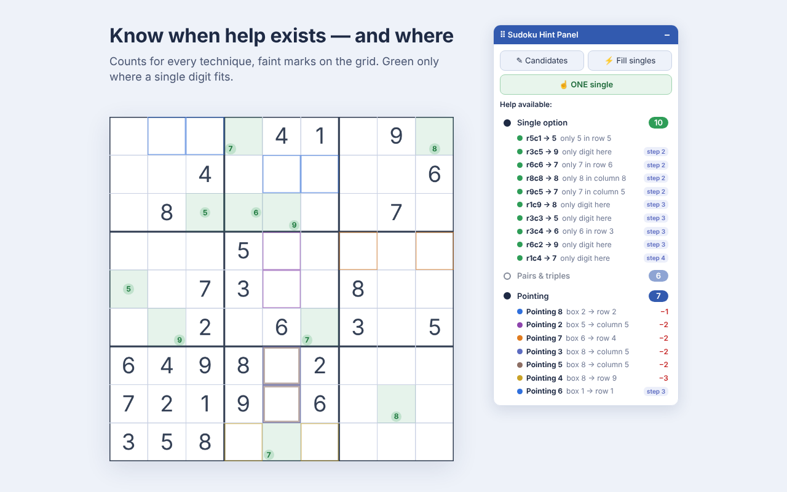
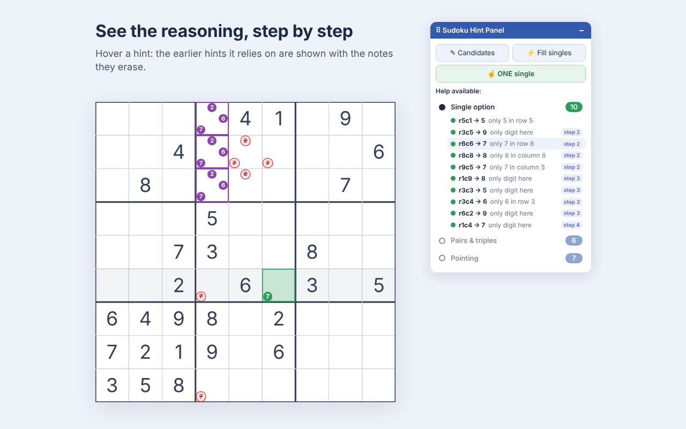

# Sudoku Hint Panel

A free, open-source Chrome extension that helps you **learn sudoku techniques** on [sudoku.com](https://sudoku.com). It tells you whether a step is available, which technique it uses and where — at the level of help you choose, one hint at a time if you like.

> Independent project — not affiliated with, endorsed by, or sponsored by Easybrain or sudoku.com.

## Learn at your own level

- **Just the counts.** The panel shows how many hints of each kind exist right now. Nothing is drawn on the grid until you open a category.
- **One technique.** Click a category to see its hints, drawn faintly on the grid.
- **One hint.** **☝ ONE single** shows a single next move, easiest first, and keeps it until you fill the cell.
- **The reasoning.** Hover any hint to see the earlier hints it relies on and the notes they erase — so next time you can spot it yourself.
- **Why it's a single — drawn on the grid.** Hover a green single (on the grid or in the list). Blue circles mark the placed digits that rule out the other options; light shading shows where to look; for “only place” singles, a grey × marks every other cell of that row, column or box. Red appears only when an earlier hint was needed: what it erased, and its cells outlined with its digits.

## Techniques

| Category | What it finds |
|---|---|
| **Single option** | A cell where only one digit fits (“only digit here”), or a digit with one place left in a row, column or box (“only 7 in row 6”). Shown in green — the only green on the board. |
| **Pairs & triples** | 2 cells of a row, column or box sharing the same 2 candidates (or 3 sharing 3): those digits can be erased from the rest of that unit. |
| **Pointing** | All of a box's candidates for a digit lie in one row or column: that digit can be erased from the rest of the line, outside the box. |

**Chained hints:** every erasure a hint allows is applied and the search runs again until nothing new appears, so hints that only exist after earlier ones are found too. They are tagged **step 2, step 3…**.

## Tools

| Button | Shortcut | Action |
|---|---|---|
| ✎ Candidates | Alt+Shift+C | Sets every empty cell's pencil notes to the digits still possible there. |
| ⚡ Fill singles | Alt+Shift+F | Types the digit into every single-option cell. |
| ☝ ONE single | Alt+Shift+O | Shows one single option (easiest first); click again for another. |
| Category titles | Alt+Shift+H / P / L | Show or hide singles / pairs & triples / pointing on the grid. |

The panel can be dragged anywhere (double-click its title bar to reset it), updates live as you play, works on a brand-new grid before your first move, and never draws over a site pop-up.

## Fair play

Regular games on sudoku.com also count for its tournaments and leaderboards. Hints give you an advantage other players don't have there — use them to learn, and play ranked games on your own.

## Install

- **Chrome Web Store:** *(link once published)*
- **From source:** download this repository, open `chrome://extensions`, switch on **Developer mode**, click **Load unpacked** and select the `extension` folder.

Works on Classic and Killer games, the daily challenge and special editions (e.g. Storybook). Requires Chrome 111 or later.

## How it works

sudoku.com draws its grid on a canvas, but keeps the live game (digits, notes, mistakes) in the page's local storage and loads each new puzzle from its own API. The extension:

- `page-bridge.js` (runs in the page) notices when the game saves a move or loads a puzzle, so hints refresh instantly;
- `content.js` reads that state, computes candidates and the techniques above (chained until nothing new appears), and draws a light overlay and the panel;
- the action buttons play through the same inputs a player uses — a click on the cell, the pencil toggle, a digit key — so everything stays in the game's undo history.

Notes you take are used once every empty cell has some (for example after **Candidates**); before that, hints come from the placed digits only, so a few reminder notes never cause a wrong hint.

## Privacy

No data is collected or sent anywhere; see [PRIVACY.md](PRIVACY.md).

## Limits

- Killer cages are not used when computing candidates (rows, columns and boxes only): hints stay correct, just less narrowed.
- **Fill singles** won't run while a wrong digit is on the board.
- The extension depends on how sudoku.com stores its games; if the site changes, the panel shows a message instead of guessing. Issues and pull requests are welcome.

## License

[MIT](LICENSE)
