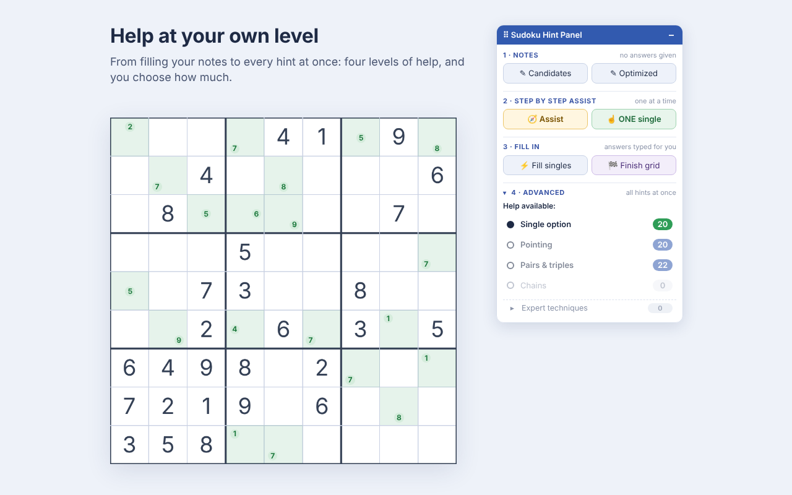
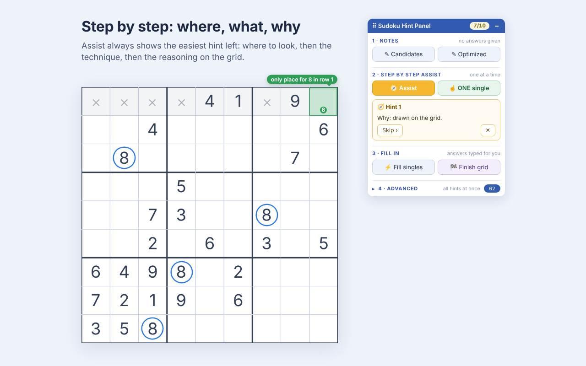
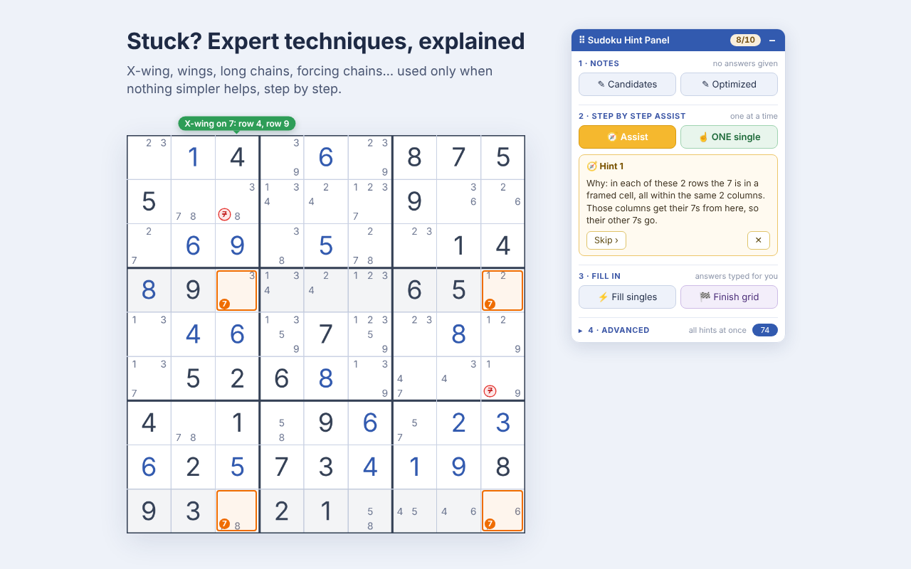
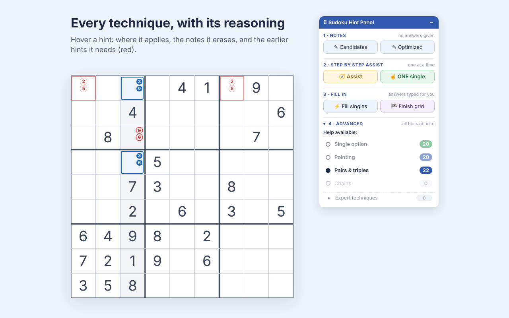

# Sudoku Hint Panel

A free, open-source Chrome extension that helps you **learn sudoku techniques** on [sudoku.com](https://sudoku.com). It tells you whether a step is available, which technique it uses and where — at the level of help you choose, one hint at a time if you like.

> Independent project — not affiliated with, endorsed by, or sponsored by Easybrain or sudoku.com.

## Learn at your own level

- **Just the counts.** The panel shows how many hints of each kind exist right now. Nothing is drawn on the grid until you open a category.
- **One technique.** Click a category to see its hints, drawn faintly on the grid. It stays on until you click it again, so you can move to the grid and hover its hints one by one.
- **One hint.** **☝ ONE single** shows a single next move, easiest first, and keeps it until you fill the cell.
- **Step by step assist.** **🧭 Assist** walks you through the puzzle one hint at a time, from the simplest technique to the most complex: first only *where* to look, then on click *what* (the technique and its cells), then *why* (the reasoning drawn on the grid). Once you apply it, the next one appears; **Skip** jumps ahead. Pairs and triples you have already noted are skipped.
- **The reasoning.** With a category on, hover one of its hints on the grid to see it in full, with the earlier hints it relies on and the notes they erase — so next time you can spot it yourself.
- **Why it's a single — drawn on the grid.** Hover a green single on the grid. Blue circles mark the placed digits that rule out the other options; light shading shows where to look; for “only place” singles, a grey × marks every other cell of that row, column or box. Red appears only when an earlier hint was needed: what it erased, and its cells outlined with its digits.

## Techniques

Listed from the simplest help to the most advanced, as in the panel. A technique is only used when everything simpler finds nothing (and, from Chains on, only when no single is left to place), so the hints stay as easy as the grid allows.

| Category | What it finds |
|---|---|
| **Single option** | A cell where only one digit fits (“only digit here”), or a digit with one place left in a row, column or box (“only 7 in row 6”). Shown in green — the only green on the board. |
| **Pointing** | All of a box's candidates for a digit lie in one row or column: that digit can be erased from the rest of the line, outside the box. And the other way round (also called claiming): all of a row's or column's candidates for a digit lie in one box, so that digit can be erased from the rest of the box. |
| **Pairs & triples** | 2 cells of a row, column or box sharing the same 2 candidates (or 3 sharing 3): those digits can be erased from the rest of that unit. **Hidden** pairs & triples too: 2 digits that fit in only the same 2 cells of a unit (or 3 in 3) — those cells' other candidates can be erased. |
| **Chains** | Where a digit has only two places in a row, column or box, one of them holds it: linked together, these cells alternate between two colours, and one colour holds all of that digit (“coloring”). A colour that would put the digit twice in one unit is wrong, so its cells lose it; a cell that sees both colours can't hold it. Drawn as blue and orange cells with their links. |

**Expert techniques** (a folded group at the end of the list):

| Category | What it finds |
|---|---|
| **Quads** | Naked and hidden quads: 4 cells holding 4 digits between them, or 4 digits fitting only in 4 cells. |
| **X-wing & fish** | X-wing, swordfish, jellyfish: in 2 (3, 4) rows a digit fits only within the same 2 (3, 4) columns — or the other way round — so it goes from the rest of those columns. |
| **Wings** | XY-wing, XYZ-wing and W-wing: cells with two or three notes that, whichever way they go, put a digit in one of two places — cells seeing both lose it. |
| **Unique rectangles** | Four cells on two rows, two columns and two boxes, three of them holding only the same pair: the fourth can't be either digit, or the puzzle would have two solutions. |
| **Long chains** | X-chains (one digit, alternating “only two places” and “see each other” links) and XY-chains (cells with two notes passing one on): one of the two ends holds the digit, so cells seeing both ends lose it. |
| **Forcing chains** | The last resort: if this cell were 5, the singles that follow would leave a cell or a unit with no possible digit — so it isn't 5. The cell tried, the singles that follow (grey) and where it breaks (red) are drawn. |

On a test set of generated hard puzzles, the panel's own hints solve them all; on the very hardest grids ever designed, it may still run out — **🏁 Finish grid** always works.

**Chained hints:** every erasure a hint allows is applied and the search runs again until nothing new appears, so hints that only exist after earlier ones are found too. They are tagged **step 2, step 3…**.

## Tools

The panel is laid out by how much help you want, from least to most. **4 · Advanced** starts folded, showing just how many hints exist; click its title to unfold it (it stays as you leave it).

| Section | Button | Shortcut | Action |
|---|---|---|---|
| **1 · Notes** — no answers given | ✎ Candidates | Alt+Shift+C | Sets every empty cell's pencil notes to the digits still possible there. |
| | ✎ Optimized | Alt+Shift+N | Same, then erases every note that pairs, triples and pointing rule out, chained until nothing changes. |
| **2 · Step by step assist** — one hint at a time | 🧭 Assist | Alt+Shift+A | One hint at a time, easiest first — where, then what, then why. Alt+Shift+A again reveals the next level. |
| | ☝ ONE single | Alt+Shift+O | Shows one single option (easiest first); click again for another. |
| **3 · Fill in** — answers typed for you | ⚡ Fill singles | Alt+Shift+F | Types the digit into every single-option cell. |
| | 🏁 Finish grid | — | Types the solution into every empty cell, for when you're stuck for good. Click twice to confirm. |
| **4 · Advanced** — all hints at once | Category titles | Alt+Shift+H / L / P / K | Show or hide singles / pointing / pairs & triples / chains on the grid; **Expert techniques** unfolds the rest. |

**Difficulty badge.** The title bar shows how hard what's left of the grid is, from 1/10 to 10/10: the hardest technique you'd need to finish from here, taking the easiest step each time (1 = only place for a digit in a box … 5 = pairs & triples … 10 = forcing chains or beyond). It goes down as you fill the grid and reads 0/10 when it's solved. Hover it for the technique.

The panel can be dragged anywhere (double-click its title bar to reset it), updates live as you play, works on a brand-new grid before your first move, and never draws over a site pop-up. When no game is in play (finished, hidden behind a pop-up or an ad, or no board on the page) it shrinks to a faded title bar, with no messages or numbers, until a grid is back.

## Fair play

Regular games on sudoku.com also count for its tournaments and leaderboards. Hints give you an advantage other players don't have there — use them to learn, and play ranked games on your own.

## Install

- **Chrome Web Store:** [Sudoku Hint Panel](https://chromewebstore.google.com/detail/sudoku-hint-panel/bhhgadcdhbondeacamocgieacckjbcon)
- **From source:** download this repository, open `chrome://extensions`, switch on **Developer mode**, click **Load unpacked** and select the `extension` folder.

Works on Classic and Killer games, the daily challenge and special editions (e.g. Storybook). Requires Chrome 111 or later.

## How it works

sudoku.com draws its grid on a canvas, but keeps the live game (digits, notes, mistakes) in the page's local storage and loads each new puzzle from its own API. The extension:

- `page-bridge.js` (runs in the page) notices when the game saves a move or loads a puzzle, so hints refresh instantly;
- `content.js` reads that state, computes candidates and the techniques above (chained until nothing new appears), and draws a light overlay and the panel;
- the action buttons play through the same inputs a player uses — a click on the cell, the pencil toggle, a digit key — so everything stays in the game's undo history.

Notes you take are used once every empty cell has some (for example after **Candidates**); before that, hints come from the placed digits only, so a few reminder notes never cause a wrong hint. If a note was erased by mistake (it rules out the digit that really goes there), the panel says so, shows where when you hover the warning, and ignores your notes until it's fixed — so a slip never turns into a wrong hint. When an explanation relies on a note you erased yourself, that cell shows ✎ instead of ×.

## Privacy

No data is collected or sent anywhere; see [PRIVACY.md](PRIVACY.md).

## Limits

- Killer cages are not used when computing candidates (rows, columns and boxes only): hints stay correct, just less narrowed.
- **Fill singles** and **Finish grid** won't run while a wrong digit is on the board. **Finish grid** is off for Killer puzzles, since cages aren't used.
- The extension depends on how sudoku.com stores its games; if the site changes, the panel shows a message instead of guessing. Issues and pull requests are welcome.

## License

[MIT](LICENSE)
